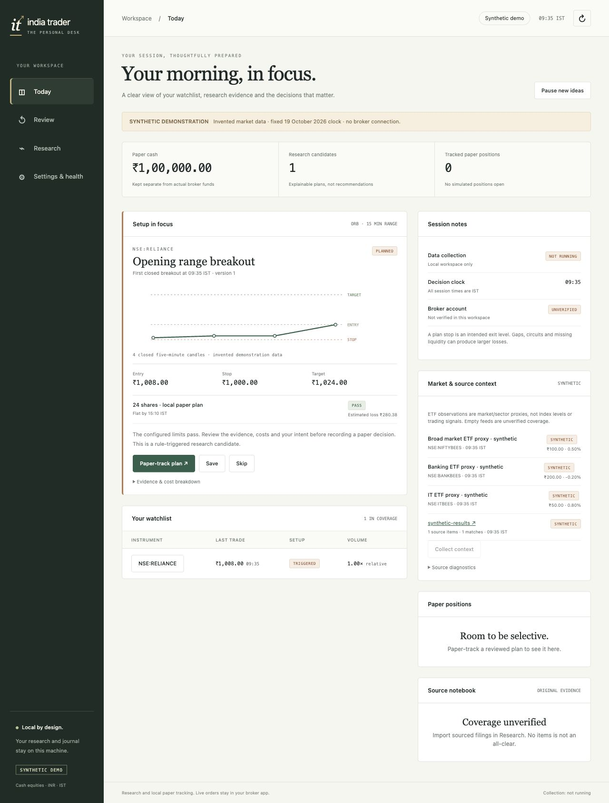

# India Day Trader

**Eleven skills for Indian cash-equity research, Groww/Zerodha market data, and local paper trading.**

**Status: v0.3 personal research desk, pending authenticated broker and market-session validation.** The local app now implements dated market policies, guided setup, read-only account/data sync, published fee estimates, risk checks, versioned plans, a paper journal, chronological replay, source-preserving imports and an observation scorecard. It has no live order submission. See [release status](docs/release-status.md), [market research](docs/research/2026-10-30-indian-market-research.md) and [roadmap](ROADMAP.md).

Scan an imported NSE/BSE watchlist, check a closed-bar entry, define a stop and target, replay historical outcomes, size in rupees, and check risk before preparing a broker ticket. Monitor sourced news, exchange disclosures and quarterly earnings alongside the trade.

Python 3.9+, no runtime dependencies. MIT licensed. All example prices, financial statements and disclosures are explicitly **synthetic**. This project has no live order-submission code.

Inspired by the workflow in [Jakeschincariol/day-trader-skill](https://github.com/Jakeschincariol/day-trader-skill). This is an original implementation for Indian cash equities, not an affiliated release or a direct port of that repository's Python code.



## Install from source

```bash
git clone https://github.com/kirasvg/india-day-trader.git
cd india-day-trader
python3 -m pip install .
india-trader --workspace trader-demo serve --demo
```

[Documentation and API](https://kirasvg.github.io/india-day-trader/) · [Contributing](CONTRIBUTING.md) · [Security policy](SECURITY.md) · [Changelog](CHANGELOG.md)

## Finish the private validation gates

[Run the complete evidence workflow](docs/finishing-the-gates.md) with synthetic inputs now, then fill in private account paths/notes later. `validate broker`, `reconcile`, `context`, `observe` and `validate readiness` implement the remaining gate workflows. Actual account/note/session evidence remains pending.

```bash
python3 scripts/evidence_demo.py
```

## Start in one minute

Open the local daily desk from this repository:

```bash
python3 -m india_trader --workspace trader-demo serve --demo
```

Open **http://127.0.0.1:8765**. Explore Today, paper-track the synthetic plan, write a note in Review, run a chronological replay in Research, and inspect Settings & health. The demo uses an explicitly frozen 19 October 2026 clock and invented prices. It never contacts a broker. Stop with Ctrl+C. Use a separate workspace for connected data.

For the eleven-skill command-line tour and checks:

```bash
python3 scripts/demo.py
python3 -m unittest discover -s tests -v
```

The tour exercises all eleven workflows, both manual ticket formats and a paper roundtrip in a temporary folder. Its seeded resampling uses 1,000 iterations for speed; the normal default is 10,000. This differs from the desk's causal chronological replay.

For an inspectable demo workspace:

```bash
python3 -m india_trader --workspace trader init --demo
python3 -m india_trader --workspace trader --now 2026-10-19T09:35:00+05:30 scan
python3 -m india_trader --workspace trader --now 2026-10-19T09:35:00+05:30 exit NSE:RELIANCE
python3 -m india_trader --workspace trader --now 2026-10-19T09:35:00+05:30 simulate
python3 -m india_trader --workspace trader --now 2026-10-19T09:35:00+05:30 budget
python3 -m india_trader --workspace trader --now 2026-10-19T09:35:00+05:30 risk
python3 -m india_trader --workspace trader --now 2026-10-19T09:35:00+05:30 broker ticket --broker groww
```

`--now` is a research clock override, not a way to make stale data current. Omit it when using current market data. Global arguments go before the subcommand. Machine-readable JSON goes to stdout; errors go to stderr. Exit codes: `0` success, `1` invalid input/operational error, `2` risk BLOCK. A waiting/expired entry is a valid research result and returns `0`.

## The eleven skills

| Skill | Implemented capability | CLI |
| --- | --- | --- |
| `india-trader-scanner` | Long fifteen-minute opening-range breakout scan over imported candles | `scan` |
| `india-trader-news` | RSS/Atom or sourced JSON news, company alias matching, catalyst tags | `news` |
| `india-trader-entry` | First closed five-minute breakout, waiting/triggered/expired states | `entry NSE:RELIANCE` |
| `india-trader-exit` | Opening-range midpoint stop, R target, instrument tick rounding, flat-by | `exit NSE:RELIANCE --target-r 2` |
| `india-trader-timemachine` | Seeded candle resampling plus historical replay of the same ORB rule | `simulate --replays 10000 --seed 19` |
| `india-trader-budget` | Whole-share INR sizing with estimated costs, cash buffer and position cap | `budget` |
| `india-trader-risk` | Fresh quote, session, stop/target, cash, daily risk and duplicate-entry checks | `risk` |
| `india-trader-broker` | Manual Groww/Kite ticket formats and local paper ledger | `broker ticket --broker zerodha` |
| `india-trader-alerts` | Stop, target, flat-by and stale-data checks with deduplicated events | `alerts` |
| `india-trader-analyst` | Sourced quarterly revenue, net profit and EPS comparisons | `analyst --file financials.json` |
| `india-trader-disclosures` | Public insider, promoter/ownership and pledge filing discovery | `disclosures --file filings.json` |

The disclosure skill replaces the US congressional tracker. It does not claim access to Indian politicians' portfolios.

## Install the skills

Install all eleven into Codex or Claude using a complete checkout:

```bash
python3 scripts/install_skills.py --platform codex
python3 scripts/install_skills.py --platform claude
```

Or install only inside a project:

```bash
python3 scripts/install_skills.py --destination /absolute/project/.agents/skills
# Claude alternative: --destination /absolute/project/.claude/skills
```

The installer bundles the engine, templates and reference docs into each independent skill. There are no symlinks or runtime dependencies on this checkout. It refuses to overwrite an existing skill. Review/remove an older installed folder explicitly before reinstalling. Skill discovery/refresh follows the host application's behavior. Nothing is automatically installed just by opening this repository.

For CLI-only installation, `python3 -m pip install .` provides `india-trader`. From a checkout, `python3 -m india_trader` or `python3 scripts/trader.py` works without installation.

## Connect your personal workspace

```bash
python3 -m india_trader --workspace trader-real setup --interactive
# Or open the guided local form:
python3 -m india_trader --workspace trader-real serve
```

Choose Groww or Zerodha, an exchange-qualified watchlist, paper capital, per-trade loss and daily risk. One provider is primary per workspace; a separate workspace keeps a second provider's facts distinct. No credentials are entered into the browser form.

Use hidden terminal prompts on macOS to store credentials in this workspace's Keychain scope:

```bash
python3 -m india_trader --workspace trader-real auth --broker zerodha --flow login
# Groww alternative:
python3 -m india_trader --workspace trader-real auth --broker groww --flow token
python3 -m india_trader --workspace trader-real doctor --online
python3 -m india_trader --workspace trader-real sync
python3 -m india_trader --workspace trader-real status
```

The Kite API secret is used once for the fixed session-token exchange and is never stored. Existing tokens are also supported. On other platforms, use `KITE_API_KEY`/`KITE_ACCESS_TOKEN` or `GROWW_ACCESS_TOKEN` in the process environment. See [connection guide](docs/onboarding.md). Never paste credentials into a chat or commit them.

`sync` fetches the current master, complete portfolio/order/cash snapshot, batched quotes where supported, and incremental five-minute candles. It preserves partial failures as health states. Today's instrument master never invents historical tick sizes or eligibility. Historical research requires sourced historical metadata and fees.

Review broker intraday eligibility, surveillance restrictions and any unverified cutoff before paper tracking. `market verify-instrument`, `market set-cutoff` and sourced import commands provide explicit review paths; inspect `--help`. The bundled **NSE 2026** calendar includes dated CAS changes and election holidays. BSE, unknown special sessions and later years require separately sourced imports. A weekly review-age guard blocks stale connected market policies.

After setup, run automatic foreground collection with the desk:

```bash
python3 -m india_trader --workspace trader-real serve --collect --interval 30
```

Collection is rate-limited REST polling with bounded backoff, incremental backfill and visible health. It is not a tick-streaming service. Sleeping or disconnecting the machine interrupts collection. Stop with Ctrl+C. `--collect` is rejected for synthetic demos. No scheduler is installed.

The older `data master`, `data candles`, `data quote` and normalized CSV/JSON import commands remain available for research. Read [data contracts](docs/schemas.md) before using them.

## News, disclosures, earnings and alerts

```bash
python3 -m india_trader --workspace trader-real news \
  --feed https://nsearchives.nseindia.com/content/RSS/Online_announcements.xml --hours 24 --new-only
python3 -m india_trader --workspace trader-real disclosures --file /absolute/path/disclosures.json --hours 48 --new-only
python3 -m india_trader --workspace trader-real analyst --file /absolute/path/financials.json
python3 -m india_trader --workspace trader-real alerts
```

Use official feed links from the [NSE RSS directory](https://www.nseindia.com/static/rss-feed). Availability and coverage can vary; an empty feed is not evidence that no announcement exists. JSON/XML import remains available when an exchange feed is unavailable. Disclosures are identified by text and need verification against the original filing. Earnings inputs are structured, sourced three-month statements; this release does not extract financial tables from arbitrary PDFs.

`watch` offers bounded foreground polling; nothing is installed as a background service:

```bash
python3 -m india_trader --workspace trader-real watch alerts --broker groww --every 30 --polls 20
python3 -m india_trader --workspace trader-real watch entry --broker zerodha --instrument NSE:INFY --every 30 --polls 20
python3 -m india_trader --workspace trader-real watch news --feed https://nsearchives.nseindia.com/content/RSS/Online_announcements.xml --every 300 --polls 12
```

Each poll uses the actual current clock. Broker refresh is optional; without it, entry/alert checks only reread local files. Feed errors stop the watch and are visible, not converted into an empty successful result.

## Paper execution

```bash
python3 -m india_trader --workspace trader-real broker paper-fill
python3 -m india_trader --workspace trader-real broker journal
python3 -m india_trader --workspace trader-real broker paper-close --instrument NSE:INFY
```

A paper fill re-runs risk and conservatively records the limit price. When an ask/depth quantity is supplied, the ask must permit the limit and visible quantity must cover the whole order. It reserves roundtrip charges up front and settles the immutable dated estimate on close. SQLite commits the paper balance, plan state and event together; account.json is a recoverable mirror. Queues, partial fills and guaranteed stops are not modeled. A paper close requires a fresh quote and is permitted after the entry cutoff. Daily risk remains reserved for every entry for the entire day. The journal is local. Read-only broker exposure remains separate; actual fills and contract-note fees are not inferred from paper outcomes.

## Boundaries and validation

- Cash equities, long positions, standard one-share lots, fully cash-funded sizing. No derivatives, short selling or leverage. MIS appears only in manual ticket formats and does not change the cash budget.
- Only the long opening-range breakout is implemented. Flags, RSI bounces, tick-level streaming and automatic whole-exchange collection are not implemented.
- Verified historical policy/metadata/fees must be provided for connected research. The demo's weekday calendar is synthetic and must never be used as an exchange holiday calendar.
- Simulated probabilities are resampling frequencies, not calibrated forecasts. Splits, dividends, changing regimes, liquidity and serial dependence require separate research.
- Dated Groww/Zerodha NSE intraday fee profiles are published estimates, with component breakdown, tick breakeven and reconciliation commands. BSE/special funding are unsupported. Legacy demo costs remain illustrative. This is not a tax, brokerage or regulatory-compliance engine. A stop price is not a maximum possible loss.
- Broker adapters have offline contract tests against documented formats. Authenticated live broker calls have not been tested with a user account. No real orders are submitted by the project.
- The current NSE announcement URL was reachable but returned zero items during a public-feed smoke check on 2026-10-30. This establishes reachability only, not complete announcement coverage.

See [implementation plan](PLAN.md), [data contracts](docs/schemas.md), [research methodology](docs/methodology.md), [sources](docs/sources.md) and [validation report](docs/validation.md). GitHub Actions runs offline tests and the demo on Python 3.9, 3.11 and 3.13 when pushed; configured CI is distinct from tests already run locally.


## Contributing and security

Read [CONTRIBUTING.md](CONTRIBUTING.md), the [code of conduct](CODE_OF_CONDUCT.md), and the [release process](docs/public-release.md). Report vulnerabilities privately using [SECURITY.md](SECURITY.md). Public issues and pull requests must use synthetic inputs and exclude account records and credentials.

## License

MIT © 2026 Kartik Parsoya and contributors. See [LICENSE](LICENSE) and [NOTICE.md](NOTICE.md). Market-data/provider rights remain separate from the project's code license.
