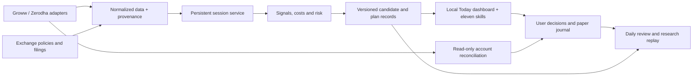

# Roadmap: a usable personal Indian trading assistant

Prepared **30 October 2026** after [Indian-market research and code assessment](docs/research/2026-10-30-indian-market-research.md). Status: **v0.3 implements the software foundation across these stages; authenticated integrations, source coverage and the 20-session operational gate remain open.** See [stage-by-stage delivery status](docs/release-status.md).

The completed v0.1 plan remains in [PLAN.md](PLAN.md). Its 60 passing offline tests are a baseline. This roadmap replaces feature-count goals with daily-workflow and market-correctness release gates.

## Product goal

On an ordinary trading morning, the user should be able to open one local assistant, see whether its data is working, understand which stocks merit attention, inspect a complete plan with realistic costs, record a decision and review the outcome. Normal use should require no manual JSON editing.

Keep both Groww and Zerodha support. Select one primary data provider per session; connecting two brokers must not double-count positions or quietly merge inconsistent price histories. Start with fully funded long cash equities, a curated eligible universe and paper/manual trading. Existing broker apps remain the place for live orders in this roadmap.

## What the daily experience should be

| Moment | User action | Assistant output | Required failure behavior |
| --- | --- | --- | --- |
| Before the open | Open Today or ask for the morning brief | Session phases/cutoffs, account exposure, sourced events, prior-session context, shortlist | Explain missing login/calendar/news coverage; do not fabricate readiness |
| After opening-range completion | Review the watchlist | A few explainable candidates, chart levels, relative volume/liquidity/context and disqualifiers | No candidate is a valid result; missing data is a separate state |
| A setup changes | Open the candidate card | Trigger/invalidation, evidence timestamps, stop/target, costs, size, exit deadline | Expire stale ideas and show what changed |
| User decides | Paper-track, save, skip or open broker app | Decision record with reasons and immutable plan version | Never treat a draft/alert as an actual fill |
| During monitoring | Check status or a notification | Active paper plans, relevant changes, remaining budget and connection health | Reconnect/backfill, mark degraded periods, retain cutoff alerts |
| After the session | Ask for review | Gross/net P&L, planned versus actual behavior, costs, missed/skipped ideas and notes | Flag unreconciled fills/fees instead of guessing totals |

Natural-language examples describe skill-mediated workflows; the stable CLI and desk actions are documented in README: “Prepare my day”, “Why is this stock on the list?”, “What invalidates this setup?”, “Show the cost breakdown”, “Paper-track this plan”, “Pause new ideas”, and “Review my day”.

## Design decisions

1. **One engine, eleven thin skills.** Skills call stable typed tools and render results. They do not copy fee arithmetic, market rules or account state into prompts. Replace independent engine copies through an explicit migration, preserving installed workspaces.
2. **Local storage by default.** SQLite for session/candidate/plan/event/journal state, versioned raw data where permitted, OS secret storage and portable exports. Account facts, simulated positions and user-entered trades remain distinguishable.
3. **Deterministic financial decisions.** Code computes bars, fees, sizing, limits and status. An optional LLM explains facts and summarizes cited filings. It does not silently change rules or infer missing prices.
4. **Dated market policies.** Exchange + security class + broker + product + effective interval determine session and risk behavior. Every policy includes source, fetched/reviewed date and version. Announced future policies stay inactive until their effective date.
5. **Useful health states.** AVAILABLE, STALE, MISSING, NOT_ENTITLED, ERROR and UNVERIFIED are separate. Feed heartbeat, last trade and last complete bar are separate clocks.
6. **Manageable initial coverage.** Discover from a defined universe; actively monitor approximately 20–50 liquid eligible stocks plus selected market/sector context. Display observed coverage. Expand only after measured resource/quota tests.
7. **Practical dependencies.** Preserve a small deterministic core. Official broker SDKs and a local UI/service may use optional dependencies if they materially improve connection reliability and installation. Record this as an architecture decision before changing the current standard-library-only policy.

The market-data/journal path stays usable without an LLM subscription. The service binds locally and does not expose broker tokens to page JavaScript, exports or logs.

## Phase 0 — Establish correctness requirements

**Purpose:** turn research findings into executable specifications before extending the engine.

Deliver a policy/source register, architecture decisions, normalized schemas and regression cases. Capture current CAS/non-CAS sessions, dated future changes, session exceptions, historical tick regimes, broker eligibility and fee-source conflicts. Validate BSE-specific sources independently. The research establishes a real problem with v0.1's 75-bar assumption; preserve a regression demonstrating the failure.

**Done when:** the spec distinguishes source fact from project policy; each P0 gap has a failing or explicit unsupported-case test; no current default is claimed to be a universal exchange rule.

## Phase 1 — Indian market and instrument engine

**Purpose:** obtain the correct market state for a security and date.

- Add security identity mapping using exchange/ISIN/series and provider IDs, with historical validity.
- Build a versioned session calendar with phases, holidays/special sessions, CAS membership and broker cutoff overrides.
- Derive candle grids from continuous-trading intervals; remove the 75-bar requirement and make historical replay use historical policy/ticks.
- Maintain tradability metadata: product eligibility, lot/tick, surveillance stage, circuits, suspension and corporate-action status. Explain unsupported/unknown states.
- Add policy refresh, provenance, explicit overrides and stale-policy diagnostics.

**Done when:** tests cover a current 72-interval CAS continuous session, a 75-interval non-CAS session, a shortened/special session and a dated rule transition. A future policy never changes an earlier replay. Unsupported trading phases cannot generate ordinary entry signals. Unknown broker exceptions stay visible.

The CAS numbers above describe the current researched cases, not a new hardcoded rule. Implementation must follow updated official policies. [Research findings 1–3](docs/research/2026-10-30-indian-market-research.md).

## Phase 2 — Guided connection and trusted data

**Purpose:** make first use possible without manually assembling state files.

Proposed commands: `setup`, `doctor`, `sync`, `status`. Provide a guided local flow for broker selection, subscription checks, user-controlled login, capital/risk preferences, instrument sync and initial history coverage. Start with one provider for a complete vertical slice, then validate the same contract against the second provider before advertising dual-provider readiness.

Use official SDK streaming adapters, shared request budgets, persisted checkpoints, incremental backfill and complete-bar finalization. Retain provider/exchange/receipt timestamps. Probe recent and older history explicitly. Re-authentication is a visible daily operation. Never implement password/TOTP scraping as a shortcut.

Add read-only holdings/positions/orders/funds ingestion. Repeated imports must be idempotent. User-confirmed imports remain available without an API subscription, with clear reduced capabilities.

**Done when:** after provider account/API setup is available, a first-time user can reach a data-ready watchlist within a **proposed 15-minute usability target**, without editing JSON. Doctor identifies missing entitlement versus expired login versus stale feed. Both brokers have private read-only integration results, and at least one full market session has been observed without fabricated fills.

## Phase 3 — Realistic costs, exposure and plan lifecycle

**Purpose:** ensure the amounts on a candidate card are meaningful.

Implement effective-dated fee schedules, separate buy/sell notionals, brokerage caps/minimums, statutory components, applicable GST and documented rounding. Reconcile dated calculations against broker calculators and actual exported contract notes where available; preserve small residual differences with explanations.

Separate three risk measures: committed worst-case estimate, realized net P&L, and current open-position stress. Include existing broker exposure in decisions. Keep the current conservative daily-reservation policy as an explicit selectable policy, not an invisible synonym for realized daily loss.

Give every candidate and plan a stable ID and states such as observed → eligible → triggered → planned → paper-tracked/skipped → closed/expired. Associate each paper fill or imported actual fill with a plan and source. Stale plans cannot silently regain validity after a reconnect. Show net reward, breakeven movement, stressed loss and operational exit deadline.

**Done when:** selected broker cases reconcile to the applicable rounding tolerance; no duplicate imports or exposure double-counting occur; state survives restart; broker facts and simulations are visually distinct; all financial calculations come from the deterministic engine.

## Phase 4 — The daily desk

**Purpose:** reduce routine operating effort and make monitoring dependable.

Build four local views: **Today**, **Review**, **Research**, and **Settings/Health**. Today contains the morning brief, watchlist, candidate cards and tracked plans. A candidate card answers why it appears, which rule fired, when the evidence became known, what invalidates it, what it costs and when the plan expires.

Add a persistent service with restart recovery, graceful reconnect/backfill, clock checks, sleep/wake detection and a health heartbeat. Keep data collection independent of chat availability. Desktop notifications are configurable, deduplicated and linked to the plan; enable other delivery channels only when the user requests them. “Pause new ideas” must describe its scope and never imply broker-side action.

**Done when:** the user can complete prepare → monitor → inspect → decide → review in the UI or natural-language skill flow with no JSON editing. A disconnect/restart produces visible degraded coverage and recovery. The user can see the last successful refresh, stale items and any position requiring attention. No critical expiry warning depends on a successful LLM call.

## Phase 5 — Evidence and journal

**Purpose:** learn from actual decisions before expanding strategy complexity.

Create an event-driven replay engine using the same bar/policy/fee code as the live research workflow. Freeze strategy versions and log parameter trials. Include rejected, skipped and non-filled signals. Add chronological evaluation, held-out periods, varying market regimes and cost/slippage stress tests. Preserve raw versus adjusted histories and historical universe membership.

Implement daily/weekly review: decision reasons, net P&L, costs, planned/actual risk, slippage, adverse/favorable excursion and rule adherence. Import actual user trade records read-only and reconcile them against the paper view. Show sample sizes and uncertainty; do not display a generic “AI confidence” score.

Keep ORB as the initial baseline. A VWAP-pullback setup can be a second research candidate only after the first workflow passes its operational gates. Additional relative-strength/volume filters must demonstrate incremental value on untouched periods before becoming default selection rules. Losing or inconclusive strategies remain visible as such.

**Done when:** replay is deterministic for a versioned dataset/policy/config; future filings, revised data and later universe membership cannot leak into earlier decisions; performance is after costs under the same model; the journal can reconstruct why a historical candidate appeared and what the user did.

## Phase 6 — Sourced news and richer Indian context

**Purpose:** reduce avoidable surprises without pretending to have complete news coverage.

Ingest official company filings with exchange/ISIN mapping, document IDs, timestamps, attachments and revisions. Use RSS as discovery with a coverage indicator and a manual original-source path. Deduplicate NSE/BSE versions. Add source-linked extraction for results, corporate actions, board meetings, promoter/ownership and pledge disclosures.

Prefer structured Integrated Filing/XBRL financials. Validate units, basis, fiscal periods, cumulative figures, derived Q4 values and restatements. Flag unsupported sector templates instead of forcing bank statements through a generic industrial-company model.

Add covered-universe breadth, sector/index comparison and official event schedules. Describe institutional flows with the correct period and provisional status. News summary failures must not stop market-data collection. Source documents are untrusted content and cannot change tool permissions or trading rules.

**Done when:** each displayed material statement links to its original evidence and availability time; revisions supersede rather than erase earlier evidence; undated/unsupported documents are marked; empty or failed feeds never produce a “news clear” status.

## Phase 7 — Prove personal usability

**Purpose:** demonstrate a full daily workflow rather than another synthetic demo.

Run private live-data shadow use for a **proposed minimum of 20 market sessions**. This is an operational observation window, not enough by itself to establish a strategy edge. Cover normal sessions, volatile periods and real or injected disconnect/expiry failures. Do not require the user to take any trades to validate the software.

Measure setup time, daily operating effort, observed/expected bar coverage, signal-processing delay after bar confirmation, reconnection recovery, missed/duplicate alerts and fee reconciliation. Record every manual repair. Ask the user which outputs actually affected a decision and which were noise.

**Proposed release targets:**

| Area | Acceptance target |
| --- | --- |
| Onboarding | Data-ready watchlist within 15 minutes after broker prerequisites are met; no manual JSON |
| Daily effort | Ordinary start/status/review flow needs no shell/file repair during the last five observed sessions |
| Data completeness | At least 99% of expected monitored continuous-session bars observed/backfilled per session; all remaining gaps visible |
| Processing latency | p95 under 3 seconds from confirmed complete-bar receipt to candidate-state update on the test machine/universe |
| Disconnect detection | Health status becomes degraded within two configured missed heartbeats; exact timing measured and exposed |
| Recovery | No duplicate candidates/fills after restart or reconnect; unresolved gaps stay marked |
| Alerts | Every injected cutoff/stale-data case handled; no repeated alert flood for unchanged state |
| Financial integrity | Reconciled example fees/exposure; every balance change traces to one journal event |
| Research integrity | No future-data leakage, explicit sample counts, deterministic replay, costs reported consistently |
| Explanation quality | Every candidate links to rule inputs and time; every filing-derived factual claim links to evidence |

These are engineering targets to validate, not current measured performance or service guarantees. If the laptop sleeps or is offline, the UI must acknowledge that continuous monitoring was unavailable. An optional always-on deployment requires a separate explicit choice and operating-cost review.

## Release sequence

| Milestone | Required phases | User-visible result |
| --- | --- | --- |
| v0.2 Connected foundation | 0–3 | Guided broker data, correct sessions/eligibility, reconciled costs and useful plan records |
| v0.3 Daily desk beta | 4 plus basic journal from 5 | One place to prepare, monitor and review; robust health and recovery |
| v0.4 Evaluated personal release | Remaining 5–7 | Sourced context, reproducible research and an observed daily workflow |

Use the first provider connection to validate the architecture early. Support for both brokers is a release claim only after both read-only contracts pass actual-account checks. Feature completion never substitutes for these gates.

## First implementation backlog

| ID | Priority | Work item | Dependency | Concrete completion artifact |
| --- | --- | --- | --- | --- |
| IND-001 | P0 | Session/policy regression specs | Research | Fixtures for current classes, special sessions and effective-date transitions |
| IND-002 | P0 | Security identity and policy store | 001 | Dated schemas, migration and source register |
| IND-003 | P0 | Remove fixed bar count; historical policy/ticks | 002 | Correct grids and deterministic multi-regime replay tests |
| IND-004 | P0 | Setup/doctor and secret storage | 002 | New-user flow plus entitlement/reconnect diagnostics |
| IND-005 | P0 | Broker sync and stream adapters | 004 | Read-only integration reports for Groww and Zerodha |
| IND-006 | P0 | Tradability and liquidity checks | 002,005 | Eligibility reasons and stale/unknown states on every monitored security |
| IND-007 | P0 | Versioned cost engine | 001 | Reconciled calculator/contract-note cases and component breakdown |
| IND-008 | P0 | Account reconciliation and journal IDs | 005,007 | Idempotent imports and isolated actual/paper ledgers |
| IND-009 | P1 | Persistent data/session service | 003,005 | Restart, gap-backfill and token-expiry failure tests |
| IND-010 | P1 | Candidate/plan lifecycle | 006–009 | Stable IDs, expiry and traceable state transitions |
| IND-011 | P1 | Today/Review/Health interface | 010 | Complete personal workflow with no JSON editing |
| IND-012 | P1 | Replay and evaluation reports | 003,007,008,010 | Chronological after-cost evidence with trial registry |
| IND-013 | P1 | Filing/XBRL evidence pipeline | 002,009 | Source-linked events, revisions and validated extraction cases |
| IND-014 | P1 | Twenty-session shadow evaluation | 011–013 | Measured release report and remaining failure log |
| IND-015 | P2 | Thin-skill packaging and migration | 004,010 | One versioned engine, backward-compatible workspace migration |

Within an item, verify the smallest complete user workflow before broadening coverage. Avoid building all eleven skills as separate applications.

## Budget and external dependencies

One chosen provider's data API is the initial recurring external cost: currently published prices are approximately ₹500/month for Kite Connect, or ₹499/month plus taxes for Groww. Confirm current entitlements before payment. Local hosting/storage adds no new cloud bill. An LLM, a second feed, commercial news/history and always-on hosting are optional budget decisions, not prerequisites. [Provider comparison and sources](docs/research/2026-10-30-indian-market-research.md).

Account-authenticated checks require the user's broker access and daily approval/login where applicable. Keep credentials on the user's machine. Contract-note reconciliation can use redacted user exports. Neither this plan nor its implementation requires placing a live trade.

## Deliberately later

Derivatives/expiry modeling, leveraged or short positions, automated live execution, public signal distribution, multi-user SaaS and cloud market-data redistribution each introduce additional modeling and operational obligations. They should receive separate researched scope if requested. A public GitHub code release can still be useful with synthetic examples and user-supplied licensed data.

Success for this personal product is trustworthy daily use: fewer manual tasks, clear evidence, visible failure states, accurate accounting and a reviewable decision history. Profitability remains an empirical strategy question rather than a product promise.
